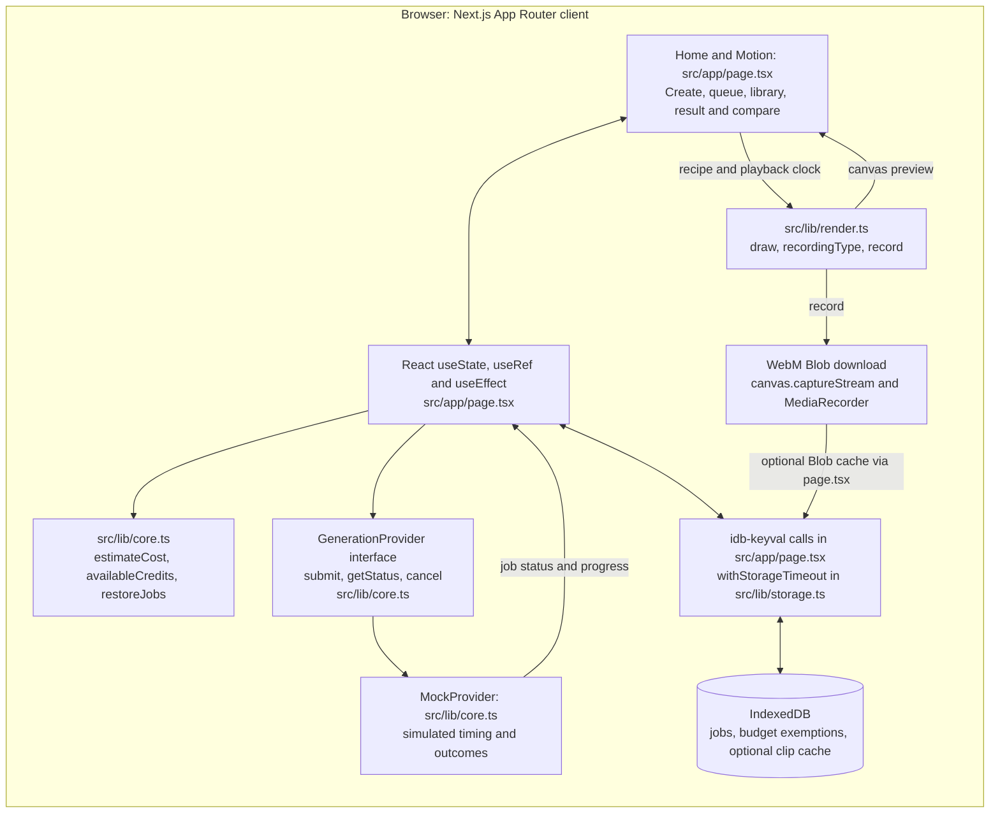
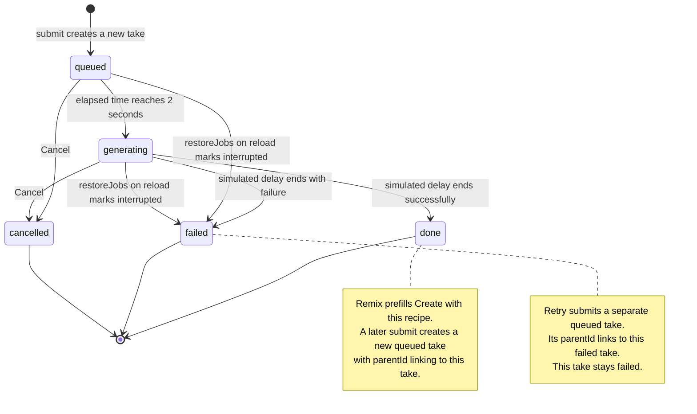

# Slate architecture

## System overview

`src/app/page.tsx` is the client App Router page: `Home` holds React state and effects, while its `Motion` component draws canvas previews; there is no external state-store library.
`src/lib/core.ts` defines the recipe and generation types, cost estimates, credit accounting, reload recovery and the synchronous `GenerationProvider` interface.
Generation is **mocked**: `MockProvider` assigns an 8-25 second delay and about a 12% failure probability, and the page polls active jobs every 500 milliseconds without calling a generation service.
The page owns Retry and Remix orchestration, selection, Keeper updates and the shared Compare playback clock; the provider does not render video.
The page reads and writes IndexedDB through `idb-keyval`, storing `slate-jobs` and `slate-budget-exemptions`, while `withStorageTimeout` in `src/lib/storage.ts` bounds operations and storage failures leave creation available in memory with a Session only warning.
`draw` in `src/lib/render.ts` creates the procedural landscape, and `record` uses canvas `captureStream(30)` plus `MediaRecorder` to produce a WebM Blob that the page downloads and optionally caches under `clip-<id>`; `recordingType` gates Download support.
A real provider would replace `new MockProvider()` in `src/app/page.tsx` using the interface in `src/lib/core.ts`, but asynchronous remote calls would also require changing the synchronous signatures and their UI callers; no real provider or server-side generation endpoint is built.

## Take lifecycle

`MockProvider.submit` creates a new ID in `queued`, and `jobStatus` reports `generating` after two seconds and `done` or `failed` when the assigned delay ends.
The page polls only queued and generating jobs, attaches a visible reason to simulated failures, and permits cancellation in either active state; terminal attempts stay unchanged.
On reload, `restoreJobs` converts persisted queued and generating attempts to failed with an interrupted reason, rather than resuming background work.
Retry calls `generate(j.recipe, j.id)`, so it creates a separate queued take whose `parentId` points to the failed attempt; the diagram intentionally does not show the original failed take returning to queued.
Remix copies the parent's recipe into Create and remembers its ID, then a later Generate creates another linked take without changing the parent's state.
`availableCredits` starts from 240 and subtracts non-exempt queued, generating and done costs, so pending takes reserve credits, completed takes consume them, and failed or cancelled takes release their reservations.
Reset demo credits preserves every take and persists their IDs as budget exemptions, restoring 240 credits for subsequent attempts without rewriting the old costs.
